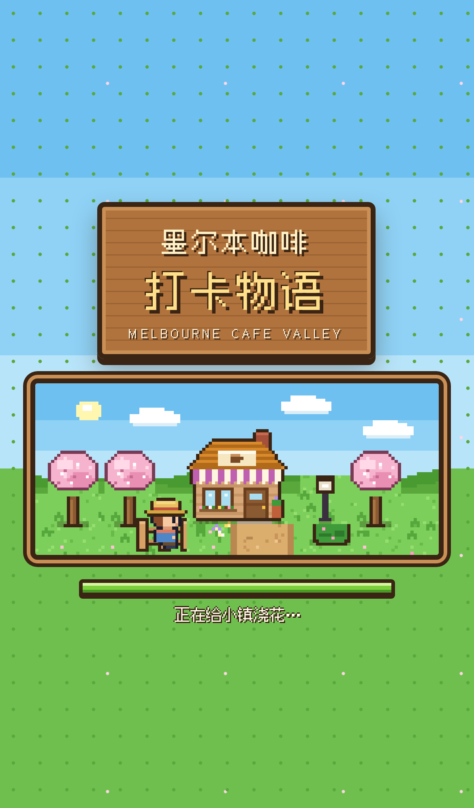
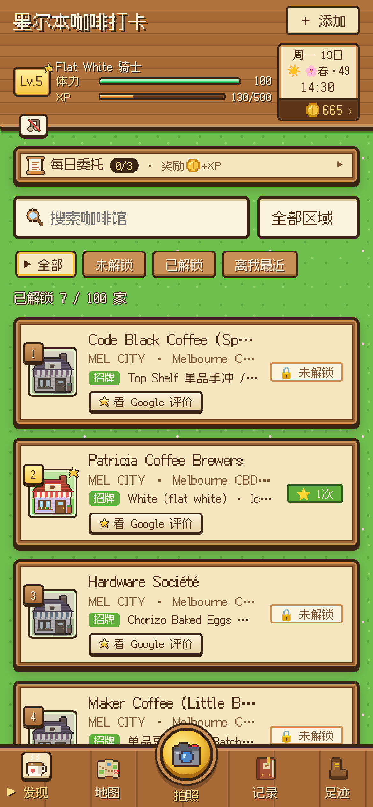
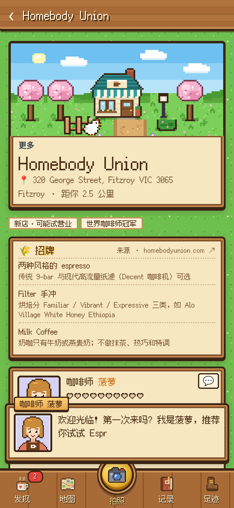
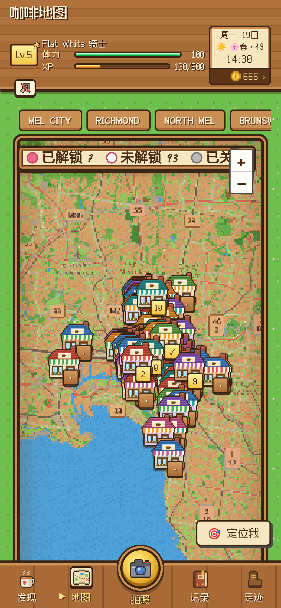
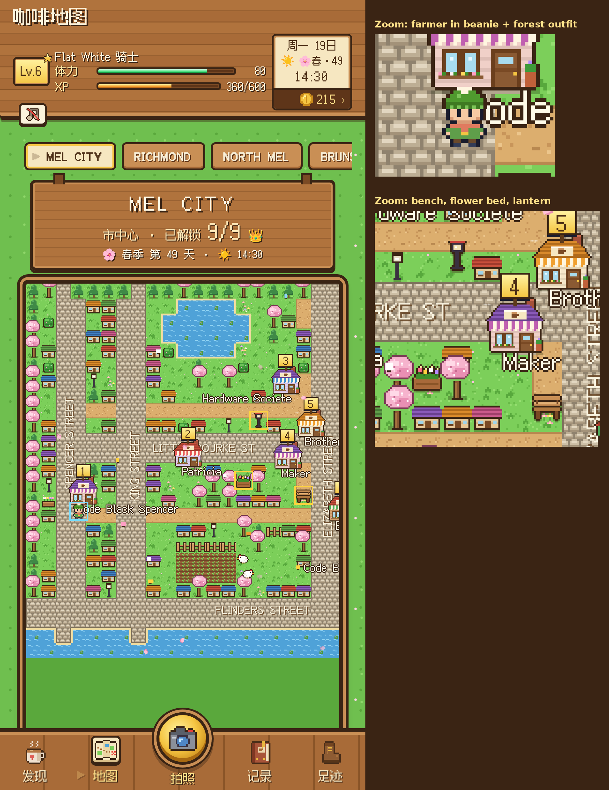
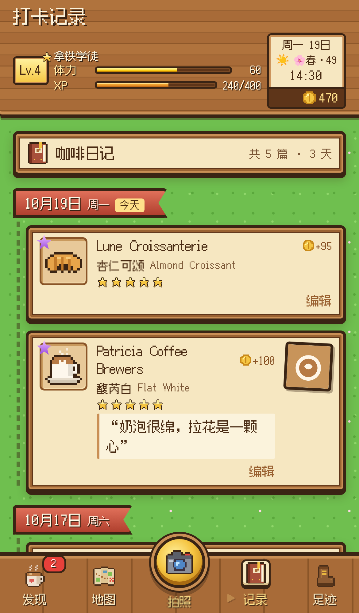

# 墨尔本咖啡打卡 · Melbourne Cafe Check-in

A cozy town-building game for checking in to 101 real Melbourne cafes: photo check-ins, a 3D village map, villager baristas, quests, a coin shop, a bean collection, an Australian festival calendar and Google review links. Five themes: 🏰 城镇 (default), 🐄 牧场, pixel valley, JRPG and hand-drawn sketch.

**Play it:** https://yurryyunyu.github.io/melb-cafe-checkin/

## Developer notes
Static mobile web app, no backend; data in localStorage. Serve the folder with any static host (HTTPS needed for camera/geolocation on phones).
- config.js — the only place for keys: GOOGLE_MAPS_API_KEY (+ optional GOOGLE_MAP_ID), VISION_API, GOOGLE_FORM.
- Google APIs to enable for the key: Maps JavaScript API, Places API (New). Restrict the key by HTTP referrer — see **Google 评价 / Google reviews** below.
- Google Form: create short-answer questions 咖啡馆/区域/点的东西/总评分/口味/颜值/性价比/心得/日期, take FORM_ID from .../forms/d/e/<FORM_ID>/viewform and entry.<id>s from a pre-filled link.
- Menus in data.js are SAMPLE data, not verified.
Local test: python3 -m http.server 8787 ; tests: /workspace/pwtest/test.mjs
- 🫘 拍豆子 (beans.js): camera button → 打卡 / 拍豆子. Bag-label photo → on-device OCR with self-hosted Tesseract.js 7 (vendor/tesseract: worker + wasm core + eng / chi_sim best_int data; lazy-loaded on first use, cached by the SW on first use, never precached). 识别中文 toggle loads chi_sim only on demand. Fields parsed heuristically (roaster, origin, region, farm, variety, process, roast, roast date, altitude, notes, weight); if VISION_API.ENDPOINT is set the photo goes there for JSON extraction first, falling back to OCR. Saved in localStorage `mcc.beans`; list/search `#/beans`, detail `#/bean/<id>` with copy/share/edit/delete. If OCR fails to load, manual entry + 重新解析 still work.
- ❤️ 体力 / HP (stamina): max 100, each check-in on today's Melbourne date costs 20 (5 cafes empties it), floors at 0. Derived purely from check-in dates, so edits/deletes update it and it refills at Melbourne midnight (the valley day summary never refills). Drop animation (shake + red flash + floating -20 / JRPG "HP -20"), green→yellow→red; barista warns at ≤40, tired hero + "体力耗尽！明天再来吧" at 0; checking in at 0 still works and unlocks ⚡ 咖啡因过载 (no XP). Beans cost nothing.

## 🎨 Themes (设置 → 界面主题)
All themes share one save: check-ins, coins, XP, stamina, quests, beans and friendship are kept when you switch.
- **🏰 城镇 / Town (default, `foundation`)**: a medieval-village look with painterly low-poly 3D, a warm pastoral palette, golden light, parchment-and-wood panels, serif headings and system-font body text (no web fonts). Each cafe is a little cottage: a dashed blue blueprint until you check in, then a built house. On the cafe page the house raises a flag after 5 check-ins. The HUD is a resource bar (coins, Lv/XP, buildings built, season·day·weather·time) with stamina underneath. The 3D map (three.js, vendored) shows winding dirt roads, orchards and wheat fields, seasonal meadow colours, a tilt-shift blur at the top and bottom, and building markers. If WebGL is missing, the map uses the 2D sketch map instead. On a slow device (median frame over 60 ms in a 12-frame probe) it switches to 2D automatically, and you can try 3D again later. Music is an optional procedural plucked "lute" tune for day and night (original, off by default).
- **🐄 牧场 / Ranch (`ranch`)**: a bright, chunky farm-life skin on the pixel valley engine. It has a date board with weekday, day, season·day, time and in-game weather, a rucksack tool bar (日历/种子袋/日记/背包/杂货店), friendship hearts with villager baristas that rise with repeat check-ins, a dialogue box with a name ribbon, and seasonal town tiles (spring blossom, summer green, autumn orange, frosty winter). On rainy days it rains, and bunting goes up on festival days. Four original seasonal chiptune variants (off by default).
- The pixel valley, JRPG and sketch themes are unchanged and still selectable. All art and music is original and drawn in code; no sprites, logos, names or melodies from any commercial game.

## 📅 Season calendar & Australian festivals (festivals.js, `#/calendar`)
Seasons follow the southern hemisphere: spring Sep–Nov, summer Dec–Feb, autumn Mar–May, winter Jun–Aug. In-game weather is deterministic per date and season and labelled as in-game, not a real forecast. Festival days show a banner, villagers say festival lines, and a 4th daily quest (check in on the festival day) pays 80 coins (+40 XP).
Victorian public holidays are computed from the rules in the Public Holidays Act, as published by Business Victoria (tests compare 2025–2027 against the official tables):
New Year's Day (1 Jan, plus the next Monday if it falls on a weekend) · Australia Day (26 Jan, moved to the next Monday if it falls on a weekend) · Labour Day (2nd Monday of March) · Good Friday, Easter Saturday, Sunday and Monday (Meeus/Jones/Butcher Easter algorithm) · ANZAC Day (25 Apr, no substitute) · King's Birthday (2nd Monday of June) · Friday before the AFL Grand Final (announced dates for 2022–2026; other years show the last Friday of September marked 约) · Melbourne Cup Day (1st Tuesday of November; some regional councils substitute a local holiday) · Christmas and Boxing Day with the VIC substitute days.
Events (not public holidays): Lunar New Year (published dates for 2021–2031 only), Moomba (2026: 5–9 Mar per City of Melbourne; other years approximated as the Labour Day long weekend, marked 约), and Melbourne International Coffee Expo (2027: 4–6 Mar, MCEC). Events without verified dates are left out.
Tests: `/workspace/pwtest/testfest.mjs` (dates + calendar UI) and `testthemes.mjs` (both themes, 3D→2D fallback, progress kept).

## ⭐ Google 评价 / Google reviews (greviews.js)
**Without a key (default):** every cafe card and detail page has a **看 Google 评价** button. It opens Google Maps for that cafe using the official Maps URLs format: `https://www.google.com/maps/search/?api=1&query=<name, address>`, plus `&query_place_id=<id>` when a place id is known. No API key is needed, and no Google API is contacted. It works in every theme.

**With a key (optional):** set `GOOGLE_MAPS_API_KEY` in `config.js`. When a cafe detail page opens, and only then, the app lazy-loads the Maps JavaScript API with the Places library (Places API New). It finds the place (`Place.searchByText`, which returns the id only) and shows the Google star rating, the review count and up to 5 recent reviews in a pixel panel. The panel shows author names linked to their profiles, the relative time, a link to all reviews on Google Maps, and the "Google Maps" attribution. If the key is wrong, quota runs out or the network fails, the panel turns into a one-line note and the button keeps working.

**What gets stored:** only the Google `place_id` is stored long-term (`localStorage['mcc.gplace']`). The rating and review content is kept in `sessionStorage` for at most 30 minutes and is never written to localStorage. This follows Google's caching rules for Places content.

### How to create the key
1. In Google Cloud Console, create or select a project and enable billing. Places API (New) is billed per request after the free monthly credit.
2. Go to **APIs & Services → Library** and enable **Maps JavaScript API** and **Places API (New)**.
3. Go to **APIs & Services → Credentials**, then **Create credentials → API key**.
4. Edit the key and set **Application restrictions** to **Websites (HTTP referrers)**. Add `https://yurryyunyu.github.io/*` (add `http://localhost:8787/*` too if you want to test locally).
5. On the same key, set **API restrictions** to **Restrict key** and select only **Maps JavaScript API** and **Places API (New)**.
6. Optionally, set quotas or a budget alert under **APIs & Services → Places API (New) → Quotas** and in **Billing → Budgets**.
7. Paste the key into `config.js` → `GOOGLE_MAPS_API_KEY: '...'` and deploy.

⚠️ **The key is public.** This is a static site, so anyone can read the key in `config.js` from the browser. The referrer and API restrictions are what stop other sites from using your quota. Never add a key without them, and never put a server or secret key in `config.js`.

Tests: `/workspace/pwtest/testgreview.mjs`. It checks the button URLs, checks that no Google API requests happen when the key is empty, and renders the panel from a fake Places response. The mock is clearly labelled TEST DATA.

## License

MIT, see [LICENSE](LICENSE). Third-party libraries in `vendor/` (Leaflet, three.js, Tesseract.js, Fusion Pixel font, etc.) remain under their own licenses.
