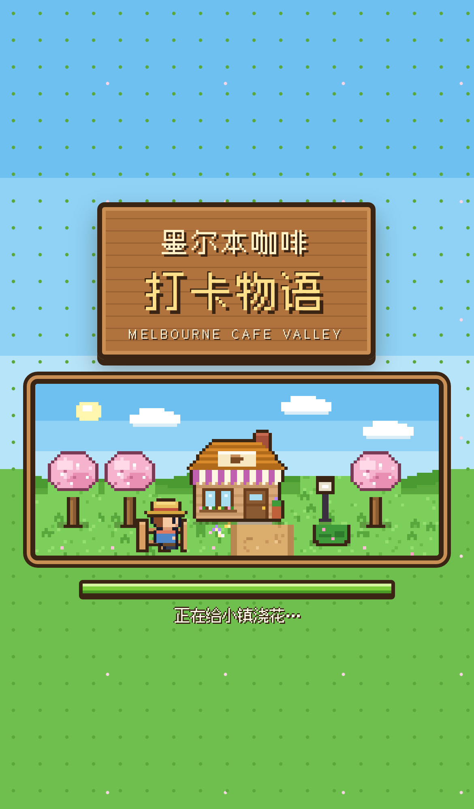
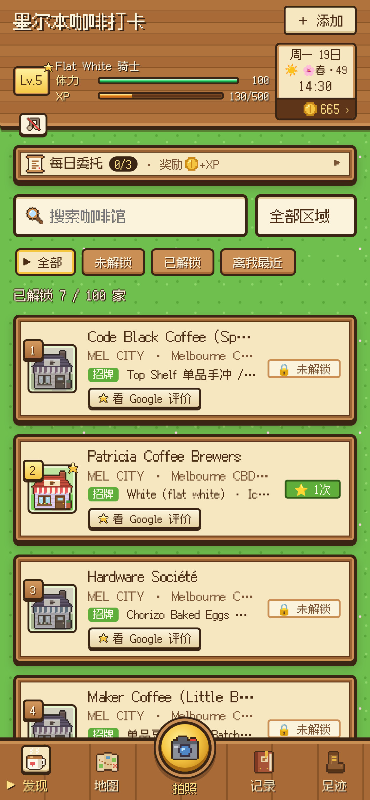
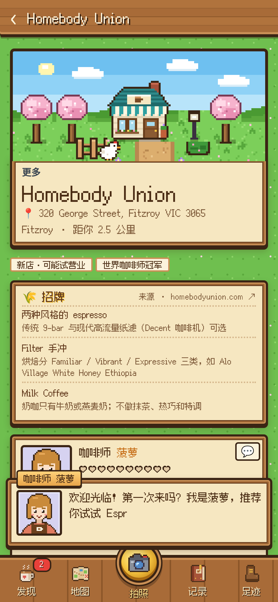
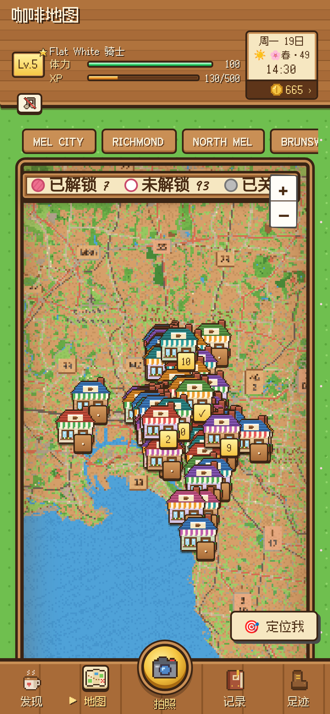
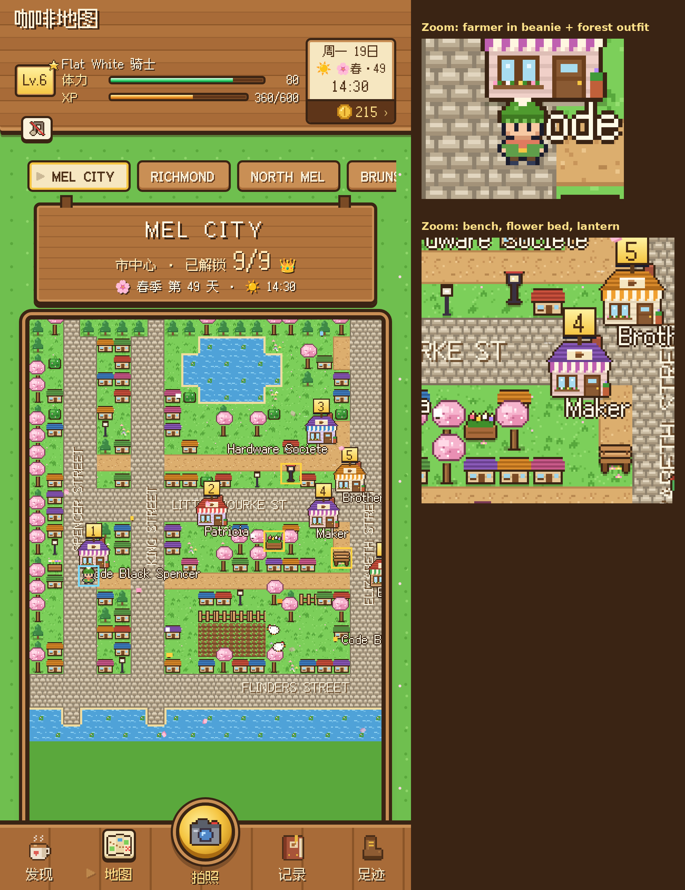
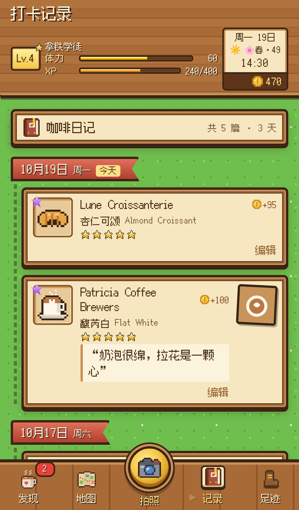

# 墨尔本咖啡打卡 · Melbourne Cafe Check-in

A cozy town-building game for checking in to 101 real Melbourne cafes: photo check-ins, a 3D village map, villager baristas, quests, a coin shop, a bean collection, a loyalty stamp booklet, an Australian festival calendar, a coffee-education main story with three endings, and Google review links. Five themes: ⚔️ 古风 (default), 🌾 田园, 🏰 城镇, 🐄 牧场, and hand-drawn sketch.

**Play it:** https://yurryyunyu.github.io/melb-cafe-checkin/

## Developer notes
Static mobile web app, no backend; data in localStorage. Serve the folder with any static host (HTTPS needed for camera/geolocation on phones).
- config.js — the only place for keys: GOOGLE_MAPS_API_KEY (+ optional GOOGLE_MAP_ID), VISION_API, GOOGLE_FORM.
- Google APIs to enable for the key: Maps JavaScript API, Places API (New). Restrict the key by HTTP referrer — see **Google 评价 / Google reviews** below.
- Google Form: create short-answer questions 咖啡馆/区域/点的东西/总评分/口味/颜值/性价比/心得/日期, take FORM_ID from .../forms/d/e/<FORM_ID>/viewform and entry.<id>s from a pre-filled link.
- Menus in data.js are SAMPLE data, not verified.
Local test: python3 -m http.server 8787 ; tests: /workspace/pwtest/test.mjs
- 🫘 拍豆子 (beans.js): camera button → 打卡 / 拍豆子. Bag-label photo → on-device OCR with self-hosted Tesseract.js 7 (vendor/tesseract: worker + wasm core + eng / chi_sim best_int data; lazy-loaded on first use, cached by the SW on first use, never precached). 识别中文 toggle loads chi_sim only on demand. Fields parsed heuristically (roaster, origin, region, farm, variety, process, roast, roast date, altitude, notes, weight); if VISION_API.ENDPOINT is set the photo goes there for JSON extraction first, falling back to OCR. Saved in localStorage `mcc.beans`; list/search `#/beans`, detail `#/bean/<id>` with copy/share/edit/delete. If OCR fails to load, manual entry + 重新解析 still work.
- ❤️ 体力 / HP (stamina): max 100, each check-in on today's Melbourne date costs 20 (5 cafes empties it), floors at 0. Derived purely from check-in dates, so edits/deletes update it and it refills at Melbourne midnight (the valley day summary never refills). Drop animation (shake + red flash + floating -20 / JRPG "HP -20"), green→yellow→red; barista warns at ≤40, tired hero + "体力耗尽！明天再来吧" at 0; checking in at 0 still works and unlocks ⚡ 咖啡因过载 (no XP). Beans cost nothing.

## 🎨 Themes (设置 → 界面主题)
All themes share one save: check-ins, coins, XP, stamina, quests, beans and friendship are kept when you switch. Empty storage opens ⚔️ 古风 (`data-theme=jrpg` and `data-xuan`, no valley skin). A one-shot migration (`localStorage['mcc.themeMig'] = 'v40'`) sends a missing theme, a legacy blue id, or a valley save that was only the old silent default to `jrpg`. It keeps `mcc.themePick` when the theme buttons were used, and it keeps a saved `ranch`, `foundation`, `sketch`, or `jrpg`. The first paint sets `data-xuan` before the stylesheets, and the blue shell rule excludes that attribute, so a late `xuan.css` cannot leave the page on the all-blue JRPG. Service worker cache: `melb-cafe-v42`.
- **⚔️ 古风 / JRPG (`jrpg`, default)**: ink-wash parchment, silk cards, lantern light, and the painted story stage. 田园 stays one tap away in 设置.
- **🌾 田园 / Valley (`valley`)**: the cozy pixel valley. Cottages, the loyalty booklet and the story panel use the wood-and-meadow frame. On the cafe page, **去这里** is fixed above the tab bar on every cafe, including a shop with no coordinates. iPhone opens Apple Maps (`maps.apple.com` with `daddr`). Android and desktop open Google Maps directions. Coordinates when the cafe has them; otherwise the name, address, suburb, and Melbourne. No Maps key is required.
- **田园 3D map**: when WebGL2 is available, the valley town opens in vendored Three.js (`vendor/three/`, no CDN). The world layer (not the panels) gets a warm sun and soft shadow, meadow fog, drifting leaves, steam on a few visited cups, and a short camera ease-in. Melbourne sits in that same toy scale: terrace rows with a lace rail and a striped awning, a narrow laneway, tram wires and one green-and-gold tram on the widest street, a Yarra-coloured ribbon, and a far silhouette — a tall gold-capped tower, a low dome, and a Ferris wheel. Sky and light follow the in-game clock (`Valley.clock`: dawn, day, 晚霞, night) and the date’s weather (clear, hot, wind, overcast, light rain). Rain is a few dozen points; wind only speeds the leaves. The choice is `localStorage['mcc.mapMode.valley']` (default `3d`). A missing WebGL2 context stays on the pixel map. A slow device (median of 12 frames over 60 ms) drops back to the pixel map; tap 3D to try again. 古风 and 牧场 keep their own map mode and still default to pixel. Closed cafes stay off the map. The panels, HUD and dialogue stay 2D.
- **墨尔本实况** (`livewx.js`): Open-Meteo, no API key, Melbourne CBD (`-37.8136, 144.9631`). Temperature, cloud, rain and wind update the home sky strip and, on 田园, the Three.js town (dusk stays 晚霞 even in rain). A reading is kept for 12 hours; if the network fails, the last reading is shown, then the in-game town weather. The home card shows 今日温度, the next few hours, and three days, in °C.
- **心理小测** (`psy.js`): after a new check-in, one short multiple-choice feeling prompt for that cafe, chosen from 100 lines by a stable hash of the cafe id. Skip does not use it up. The answer is stored in `localStorage['mcc.psy']` (`{v:1,a}`) and can add 4–8 coins once through the quest ledger (`psy-<cafeId>`). It does not change story 好感, the three endings, or the 51-cafe gate. The stamp dialog can show the saved line. These are not SCA exams.
- **Home:** 发现 leads with one action for today — open the story when a scene is ready, open the stamp book when a new stamp or a full set is waiting, otherwise check in once. Coffee course, the idle shop, SCA practice, hidden characters and the quest board sit under 发现 · 更多玩法, and the same links sit in 设置.
- **🏰 城镇 / Town (`foundation`)**: a medieval-village look with painterly low-poly 3D, a warm pastoral palette, golden light, parchment-and-wood panels, serif headings and system-font body text (no web fonts). Each cafe is a little cottage: a dashed blue blueprint until you check in, then a built house. On the cafe page the house raises a flag after 5 check-ins. The HUD is a resource bar (coins, Lv/XP, buildings built, season·day·weather·time) with stamina underneath. The 3D map (three.js, vendored) shows winding dirt roads, orchards and wheat fields, seasonal meadow colours, a tilt-shift blur at the top and bottom, and building markers. If WebGL is missing, the map uses the 2D sketch map instead. On a slow device (median frame over 60 ms in a 12-frame probe) it switches to 2D automatically, and you can try 3D again later. Music is an optional procedural plucked "lute" tune for day and night (original, off by default).
- **🐄 牧场 / Ranch (`ranch`)**: a bright, chunky farm-life skin on the pixel valley engine. It has a date board with weekday, day, season·day, time and in-game weather, a rucksack tool bar (日历/种子袋/日记/背包/杂货店), friendship hearts with villager baristas that rise with repeat check-ins, a dialogue box with a name ribbon, and seasonal town tiles (spring blossom, summer green, autumn orange, frosty winter). On rainy days it rains, and bunting goes up on festival days. Four original seasonal chiptune variants (off by default).
- Sketch stays selectable. All art and music is original and drawn in code; no sprites, logos, names or melodies from any commercial game.

## 📅 Season calendar & Australian festivals (festivals.js, `#/calendar`)
Seasons follow the southern hemisphere: spring Sep–Nov, summer Dec–Feb, autumn Mar–May, winter Jun–Aug. In-game weather is deterministic per date and season and labelled as in-game, not a real forecast. Festival days show a banner, villagers say festival lines, and a 4th daily quest (check in on the festival day) pays 80 coins (+40 XP).
Victorian public holidays are computed from the rules in the Public Holidays Act, as published by Business Victoria (tests compare 2025–2027 against the official tables):
New Year's Day (1 Jan, plus the next Monday if it falls on a weekend) · Australia Day (26 Jan, moved to the next Monday if it falls on a weekend) · Labour Day (2nd Monday of March) · Good Friday, Easter Saturday, Sunday and Monday (Meeus/Jones/Butcher Easter algorithm) · ANZAC Day (25 Apr, no substitute) · King's Birthday (2nd Monday of June) · Friday before the AFL Grand Final (announced dates for 2022–2026; other years show the last Friday of September marked 约) · Melbourne Cup Day (1st Tuesday of November; some regional councils substitute a local holiday) · Christmas and Boxing Day with the VIC substitute days.
Events (not public holidays): Lunar New Year (published dates for 2021–2031 only), Moomba (2026: 5–9 Mar per City of Melbourne; other years approximated as the Labour Day long weekend, marked 约), and Melbourne International Coffee Expo (2027: 4–6 Mar, MCEC). Events without verified dates are left out.
Tests: `/workspace/pwtest/testfest.mjs` (dates + calendar UI) and `testthemes.mjs` (both themes, 3D→2D fallback, progress kept).

## 📖 咖啡课 / Coffee course (edu.js, `#/edu`)
This is a course in 8 chapters, taught by the mentor villager 老焙. It takes you from 咖啡小白 through 识豆学徒 → 处理法见习生 → 烘焙观察员 → 萃取学徒 → 奶咖手艺人 → 手冲练习生 → 杯测品鉴师 to 咖啡大师. The chapters cover origins & varieties, processing, roasting, espresso extraction, milk & latte-art basics, filter/pour-over, tasting & cupping, and Melbourne coffee culture.
- Each chapter has a short dialogue lesson with class notes, then 2–3 tasks, then a 4-question quiz. Pass with 3/4 to rank up, and retry as often as you like (the options reshuffle each time).
- Tasks are checked only against data the app already stores: check-in drink names (Long Black / Flat White / Filter …), ratings, photos and notes, bean fields (origin, process, roast), cafe tags (烘焙商, 手冲) and the researched signatures. Homebody Union and the other filter cafes are suggested as targets. Past check-ins count.
- Rewards are coins and XP through the existing quest ledger, plus cosmetics in the pixel shop: 手摇磨豆机 (ch 3), 杯测白袍 (ch 7) and 咖啡学士帽 (ch 8). Progress is saved in `localStorage['mcc.edu']`.
- The lessons are original Simplified Chinese, checked against SCA (cupping protocol, Golden Cup, flavor wheel), World Coffee Research, roaster and barista education pages, and Melbourne history sources. Tests: `/workspace/pwtest/testedu.mjs`.

## 📜 主线剧情「第一颗豆」 / Main story v3 (story.js, story.css, `#/story`)
An original, Simplified-Chinese story that ties the check-ins, the coffee course and the bean notes together: a newcomer to Melbourne meets the retired roaster 老焙, who has lost a recipe-and-memory book torn into pages and hidden in cafes around the city. Prologue + 9 chapters + a final page + an epilogue. Ten area side stories stay.
- **Objectives** stay area/count based (distinct cafes per area, course chapters, bean notes, ratings, photos, level), never one specific cafe. Existing check-ins count. Choices never skip a chapter gate. Save `localStorage['mcc.story']` is `v:3`. A v2 save that already finished the epilogue stays on **人走茶凉**.
- **Love, hate, loyalty, forgiveness** run through the dialogue, not as separate modes: 林 and 老焙's old love and the regret of words said too late; 金远's apprenticeship, the theft, and the ambition that turned a name into 128 shops; 澈's love-hate toward 老焙 and the thin bond she offers the player; 小豆's innocence set against a home that can be lost. Choices are wounds or mercies. No real cafe owners are named.
- **Side stories** stay side stories (same triggers, coins, and 好感), and they carry the same wound: a cup bought for someone who no longer comes, an apprentice who was shouted out and came back, 澈 refusing the empty chair, 小豆 insisting the alley is still theirs.
- **Valley art** (the default skin) draws its own cottages, meadow, wood frames, dialogue portraits and loyalty-stamp faces in code. **古风** story portraits and scene backdrops are original ink-wash paintings; 老焙 wears a 斗笠, a long robe, a sword, and still holds a cup. No outside sprites. Service worker cache: `melb-cafe-v42`.
- **Choices:** k1–k7 (ch 2, 3, 5, 6, 8, 9, and the final page). Skipping auto-picks the default. They change later lines, 好感, and which ending plays.
- **Three endings** (priority `first` > `lamp` > `tea`), and only after **more than 50 distinct cafe check-ins** (51+). If every chapter is done but the count is lower, the story page asks you to keep checking in. Side stories can still play while you do.
  - `tea` 人走茶凉 — write the last page (or return the book without the hope conditions). The 江湖's lamps go out. Title 最后的读者, 🪙200.
  - `lamp` 灯火未熄 — leave the last page blank. The town fades, the alley lamp stays. Title 守灯人, 🪙220.
  - `first` 第一颗 — give the book back to the alley, reconcile with 金远 (a seat at ch 9, or a seat / hearing him out at ch 8), and both 老焙 and 澈 at 好感 ≥ 5. 远焙 steps back, 澈 and 小豆 reopen the shop, 老焙 retires. Title 第一颗的证人, 🪙260.
- **Ending (tea, the tragedy):** foreshadowed from chapter 1. No gore. Hidden-NPC lines appear only if that character has already been met; nothing in the script says how to meet one.
- **Finale presentation:** tea still dissolves the painted map into ink (古风) or greys the shop icons (other themes), then the ending card. lamp and first keep their own lines and card; the alley lamp or the reopened shop is the last image. Afterwards 主线 shows 已完结 and the ending name, and can replay that epilogue. On tea, the idle shop is labelled 回忆; on lamp the lamp is still on; on first the shop is open again.
- **集卡 / loyalty** (`loyalty.js`, `#/loyalty`, also linked from 发现 and 足迹): `localStorage['mcc.loyalty']`. One stamp per cafe on the first check-in, stars at the 3rd / 5th / 10th visit (same idea as hearts). Story cards for chapters, side stories, 10/25/51-cafe milestones and each ending you actually reach (the ending card needs the same 51-cafe gate). Region sets of still-open seed cafes exchange once for a title and coins. No gacha. Badges and the bean codex stay separate. Missing story cards are silhouettes. A card can be shared as a generated image. Tests: `pwtest/testloyalty.mjs`.
- **好感:** 老焙 初识→熟络→知己→莫逆, 澈 戒备→松动→信任→同路 (0–12). Gifts: 10 生豆 (from the idle shop) = +1, max 4 per person. High 好感 unlocks extra lines.
- **食谱簿:** six recovered pages (ch 1, 3, 4, 5, 8, 9) are readable illustrated items with 林's handwritten note (reward card chip or the 主线 page shelf).
- **支线:** ten short side stories (two per area), triggered by checking in at different cafes in that area, one at a time, +40–60 coins each.
- **Presentation:** painted scene backdrops per chapter (small lazy-loaded WebP), foreground figures (you left, speaker right), screen shake / fades, typewriter text, chapter title cards; 澈 and the player are painted full-body 古风 figures. The other themes keep their own dialog skins with pixel portraits.
- Hidden characters may cameo only after the player has already met them; no line ever says how to meet one. Under browser automation (`navigator.webdriver`) cutscenes stay off unless `?story` or `localStorage['mcc.storyTest']` is set. Tests: `/workspace/pwtest/teststory.mjs`. Full script: `research/story.md` (generated by `research/gen-story.js`, not published).

## 🏮 放置玩法「老焙的小铺」 / Idle roastery (idle.js, idle.css, `#/idle`)
Production is computed from timestamps when you come back — nothing runs in the background. State: `localStorage['mcc.idle']` (additive; nothing else changes). Coins collected from the shop count in the same wallet as the pixel shop; no XP is given for idle income.
- **Offline cap:** 12 h (+2 h per 仓库 level, max 24 h). Base 1.0 🪙/h; 烘豆机 (6 lv, +0.8 🪙/h & +0.6 🫘/h each, starts at Lv 1 → 1.8 🪙/h), 磨豆机 (5 lv, +0.7), 意式咖啡机 (4 lv, +0.9, needs 生豆), 手冲吧台 (3 lv, +1.4 & +0.3 🫘/h, needs 生豆). Costs: first open 50 / 200 / 600 / 1500, each level ×1.35 / 1.38 / 1.42 / 1.48; the two top stations also need 生豆 ≈ coins/30. Total station sink ≈ 14.5k 🪙, apprentices 400 / 1000 / 2400 / 5600.
- **Multipliers:** each real check-in made on its own day = +50 % for 6 h (stacks to ×3; back-filled check-ins never count); 学徒 +6 % each; each met hidden character helps +2 % (白先生 +5 %); each relic +1 %; each finished chapter +2 % (≤ +20 %). Only characters you have met are listed.
- **生豆 🫘** feed the story (gifts → 好感), expeditions and the top stations.
- **出门游历:** up to 3 trips a day: 巷口转转 (30 min, 5🫘, 10–20🪙), 渡口与集市 (2 h, 15🫘, 40–70🪙), 远山古道 (6 h, 40🫘, 140–200🪙); loot is seeded (no save-scumming), plus a story snippet that follows your chapter, and 12 collectible relics (老焙 finds relics more often, you bring back more coins).
- **“你不在时…”** popup on return after ≥ 30 min away (auto popups are off under automation unless `?idle` or `mcc.idleTest`).
- **Balance (simulated with the real engine, assuming a 60 🪙/day base from normal play):** a player who collects once a day earns about 23 🪙 on day 1, ~110 on day 7 and ~370 on day 30 (≈ 6k gross over 30 days); two visits + two check-ins a day ≈ 74 → 340 → 840/day. The whole 放置 tree costs ≈ 24k, and the shop total is ≈ 9.8k, so idle gold is mostly reinvested; it supplements, rather than replaces, check-in rewards. Tests: `/workspace/pwtest/testidle.mjs`.

## 🎭 隐藏角色 / Hidden NPCs (npc.js, `#/npc`)
The town has 10 original hidden characters who only appear when a condition is met:
- **Easy:** tap the title 5 times; open the closed Hash Specialty Coffee page; check in on an in-game rainy day.
- **Depends on timing:** check in between 04:00 and 07:00 Melbourne time; open the app on a Victorian holiday or festival day; run your stamina down to 0.
- **Long-term:** check in 5 days in a row; collect beans with 3 different processes; check in 10 times at one cafe; finish the coffee course.

Each character has their own dialogue, which opens as an encounter. You get coins and XP through the quest ledger. The festival guest and the old barista also give unique cosmetics for the pixel shop.

The codex (图鉴) shows unmet characters as `?` silhouettes with vague hints. Conditions based on stored data count past records. Stamina 0, the title tap and the Hash page only count at the time they happen.

Progress is stored in localStorage under `mcc.npc`. Tests: `/workspace/pwtest/testnpc.mjs`. Under automation, encounters stay off unless `?npc` or `mcc.npcTest` is set.

## 🎓 SCA 问答 / SCA quiz (sca.js, `#/sca`)

首页和「咖啡课」页都有入口 `#/sca`。题目按 SCA 咖啡技能课程（Coffee Skills Program）分为初级 Foundation 和中级 Intermediate：

- **题量：** 共 182 道原创练习题，每个模块 16–17 题。Introduction to Coffee 只有初级，SCA 没有设中级。
- **练习：** 答完马上看解析和出处，答错的题自动进错题本。
- **模考：** 随机抽 10 题（或整个模块），可以选择计时，每题 60 秒，时间到自动交卷。也有本级综合模考（20 / 30 题）。
- **奖励：** 某个模块的模考（至少 10 题）第一次达到 80%，就算「已掌握」，奖励 🪙40（初级）或 🪙60（中级），外加一半的 XP。每个模块只发一次，总共最多 🪙540。
- **存储：** 进度存在 `localStorage` 的 `mcc.sca` 里。

> **非 SCA 官方题库，仅供练习。** 题目依据 SCA 公开的课纲、Coffee Standards、Protocols & Best Practices，以及 World Coffee Research、ISO 4120 和同行评审文献的综述写成，不是考试真题，也不代表 SCA 认可。SCA 在 2024 年改用 CVA 杯测标准，所以涉及 2004 版杯测表的题都标明了版本。题库在 `sca.js`。

## 🌐 官网 / Instagram links (websites.js)
Each cafe page has a **官网** button, or **Instagram** when the cafe has no official site, and each card shows a small globe or Instagram icon. Links open in a new tab with `rel=noopener`. The links come from `research/websites.json`, where every URL was fetched and checked to name the venue. Multi-venue brands link to the location page where one exists. There are 99 links: 89 websites and 10 Instagram accounts. Two cafes have no verified link, so no button is shown: Hash Specialty Coffee (closed) and Reunion and Co (the site doesn't load). Tests: `/workspace/pwtest/testweb.mjs`.

## ⭐ Google 评价 / Google reviews (greviews.js)
**Without a key (default):** every cafe card and detail page has a **看 Google 评价** button. It opens Google Maps for that cafe using the official Maps URLs format: `https://www.google.com/maps/search/?api=1&query=<name, address>`, plus `&query_place_id=<id>` when a place id is known. No API key is needed, and no Google API is contacted. It works in every theme.

**With a key (optional):** set `GOOGLE_MAPS_API_KEY` in `config.js`. When a cafe detail page opens, and only then, the app lazy-loads the Maps JavaScript API with the Places library (Places API New). It finds the place (`Place.searchByText`, which returns the id only) and shows the Google star rating, the review count and up to 5 recent reviews in a pixel panel. The panel shows author names linked to their profiles, the relative time, a link to all reviews on Google Maps, and the "Google Maps" attribution. If the key is wrong, quota runs out or the network fails, the panel turns into a one-line note and the button keeps working.

**What gets stored:** only the Google `place_id` is stored long-term (`localStorage['mcc.gplace']`). The rating and review content is kept in `sessionStorage` for at most 30 minutes and is never written to localStorage. This follows Google's caching rules for Places content.

### How to create the key
1. In Google Cloud Console, create or select a project and enable billing. Places API (New) is billed per request after the free monthly credit.
2. Go to **APIs & Services → Library** and enable **Maps JavaScript API** and **Places API (New)**.
3. Go to **APIs & Services → Credentials**, then **Create credentials → API key**.
4. Edit the key and set **Application restrictions** to **Websites (HTTP referrers)**. Add `https://yurryyunyu.github.io/*` (add `http://localhost:8787/*` too if you want to test locally).
5. On the same key, set **API restrictions** to **Restrict key** and select only **Maps JavaScript API** and **Places API (New)**.
6. Optionally, set quotas or a budget alert under **APIs & Services → Places API (New) → Quotas** and in **Billing → Budgets**.
7. Paste the key into `config.js` → `GOOGLE_MAPS_API_KEY: '...'` and deploy.

⚠️ **The key is public.** This is a static site, so anyone can read the key in `config.js` from the browser. The referrer and API restrictions are what stop other sites from using your quota. Never add a key without them, and never put a server or secret key in `config.js`.

Tests: `/workspace/pwtest/testgreview.mjs`. It checks the button URLs, checks that no Google API requests happen when the key is empty, and renders the panel from a fake Places response. The mock is clearly labelled TEST DATA.

## License

MIT, see [LICENSE](LICENSE). Third-party libraries in `vendor/` (Leaflet, three.js, Tesseract.js, Fusion Pixel font, etc.) remain under their own licenses.
